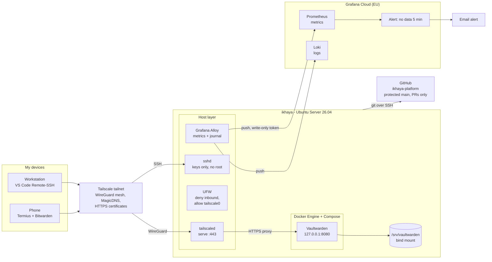
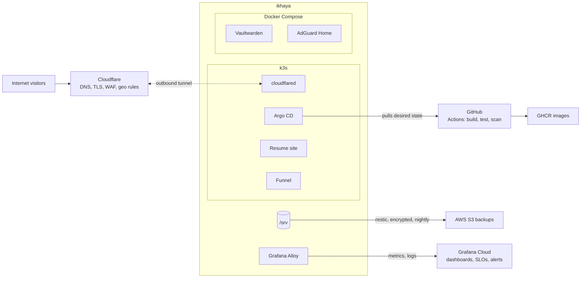

# Architecture

ikhaya is a single home server run like a small production platform. Nothing listens on the home router: private access goes through a Tailscale mesh VPN, monitoring data is pushed out to Grafana Cloud, and public traffic (later phases) will arrive through an outbound Cloudflare Tunnel.

## Current state

## Target state (later phases)

## Design principles

| Principle | How it shows up |
|---|---|
| No inbound ports | Admin access over Tailscale only; monitoring pushes out; public traffic via an outbound tunnel |
| Least exposure | Container ports bound to `127.0.0.1`, published to the tailnet with `tailscale serve` |
| Least privilege | Monitoring token can only write data; root never used day to day |
| Everything in Git | Changes land through branches and pull requests on a protected `main` |
| Secrets never in Git | `.gitignore`, push protection, uncommitted `.env` files and root-owned credential files |
| Data separate from code | All state under `/srv`, bind-mounted; containers are disposable |
| Pinned versions | Images pinned to exact tags; upgrades are reviewed pull requests |
| Prove it, don't assume it | Fixes verified after reboot; alerts tested with outage drills |

## Operations

| Area | Where |
|---|---|
| Decisions | [Architecture Decision Records](adr/) |
| Incidents | [Postmortems](postmortems/), starting with the [2026-10-19 Wi-Fi outage](postmortems/2026-10-19-wifi-outage.md) |
| Monitoring | Grafana Cloud: host metrics, system logs, "ikhaya is silent" alert (~10 min detection, drill-tested) |

## Roadmap

| Phase | Theme | Status |
|---|---|---|
| 0 | Foundations: hardened host, Tailscale, Git workflow, Docker, Vaultwarden | Done |
| 1 | Host as code (Ansible), AdGuard DNS, restic backups with tested restores | In progress |
| 2 | k3s and public edge through Cloudflare Tunnel, Cloudflare in Terraform | Planned |
| 3 | CI/CD and GitOps: GitHub Actions, image scanning, Argo CD | Planned |
| 4 | Observability: Grafana Cloud foundation **live**; dashboards, SLOs and service checks next | Started |
| 5 | Disaster recovery drills on AWS | Planned |
| 6 | Kubernetes security hardening | Planned |
